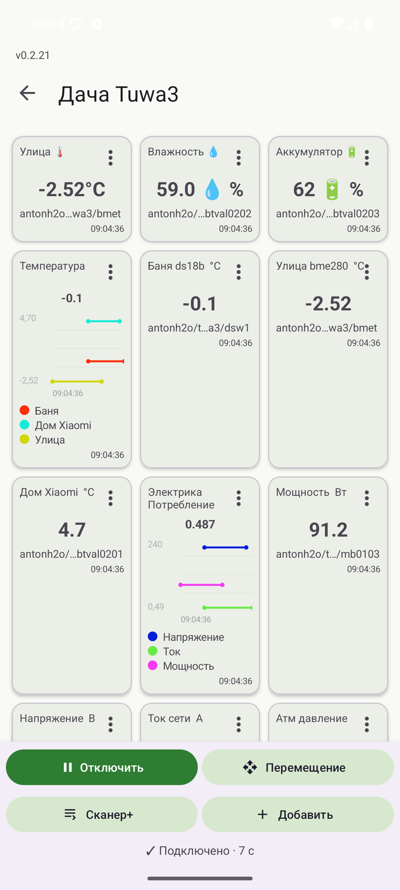
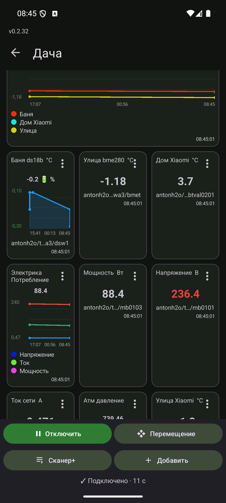
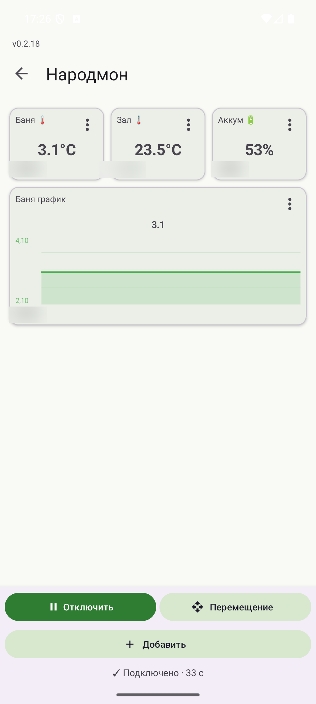
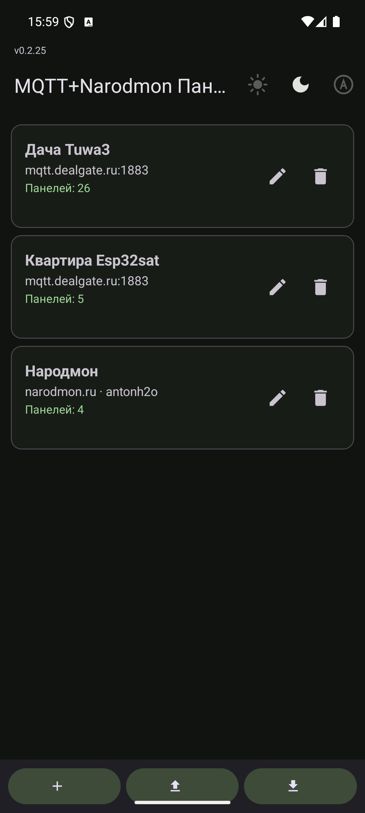
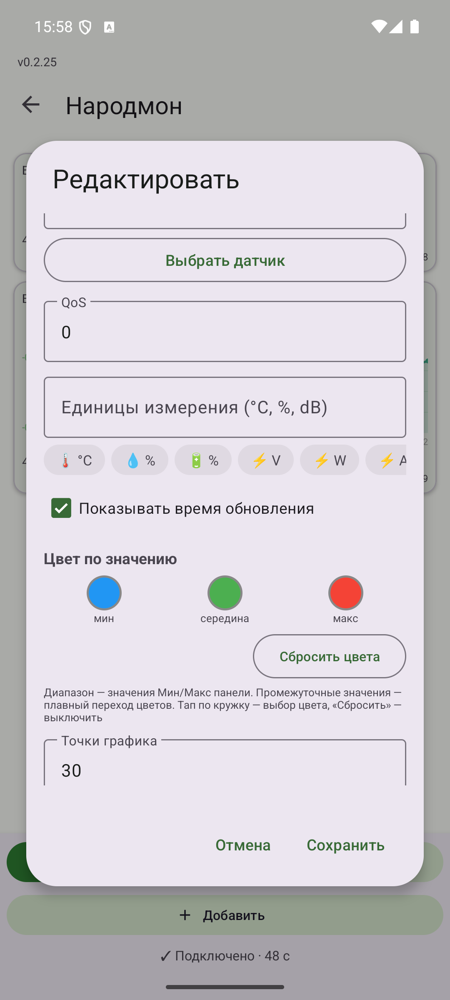
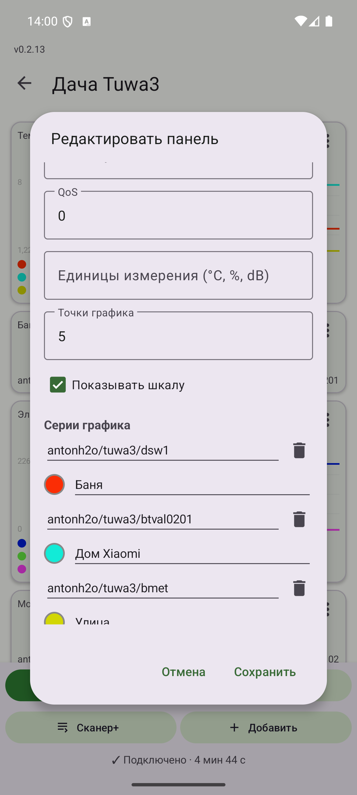

# MQTT+Narodmon Панель

Android-дашборд для [MQTT](https://mqtt.org/)-брокера и платформы [narodmon.ru](https://narodmon.ru): карточки-виджеты показывают значения топиков и датчиков в реальном времени и отправляют команды обратно брокеру. Функциональный аналог популярного [IoT MQTT Panel](https://play.google.com/store/apps/details?id=snr.ptt.iot.mqtt.panel) с импортом его конфигураций — переезд с сохранением всех дашбордов занимает пару минут.

**Текущая версия:** 0.2.33 · minSdk 24 (Android 7.0) · Kotlin · Eclipse Paho 1.2.5

| Дашборд: мультиграфик + шкала времени | Карточки с эмодзи и динамическим цветом |
|---|---|
|  |  |
|  |  |
|  |  |

## Возможности

**Виджеты** — 8 типов: Значение, Переключатель, Кнопка, Слайдер, Светодиод, Текст, График и **Мультиграфик** — несколько топиков на одном графике с легендой цветов (линии, подписи и темы серий настраиваются в редакторе панели; удобно для «Температура: Баня / Дом / Улица» или «Электрика: Напряжение / Ток / Мощность»).

В названии и в единицах измерения карточки можно использовать эмодзи: `🌡`, `💧 %`, `🔋 %` — значения читаются с одного взгляда (см. скриншот выше).

**Сетка 6 колонок** — каждая карточка занимает всю ширину, 1/2 или 1/3; перестановка drag & drop в режиме «Перемещение».

**Сканер топиков** — временная подписка на `#` собирает всё дерево брокера; для найденных тем виджеты создаются пачкой, тип подбирается автоматически по содержимому (число → Значение, `ON/OFF/true/false` → Переключатель, иначе Текст).

**Совместимость** — импорт экспорта IoT MQTT Panel (старый вложенный формат ~dataVersion 54 и плоский v214 с id вида `connection_13`), combo-графики становятся мультиграфиками. Свой конфиг — JSON с экспортом/импортом.

**Подключения** — TCP, SSL/TLS, WebSocket (`ws://`/`wss://`), логин/пароль, Keep Alive, Clean Session, QoS 0–2, Retained, свой Client ID (при импорте генерируется новый, чтобы два устройства не выбивали друг друга на брокере).

**Динамический цвет значения** — три опорных цвета (минимум → середина → максимум) по диапазону Мин/Макс панели; промежуточные значения получают плавный переход оттенков. Работает для Значения, Текста, Графика и Мультиграфика — линия и точки красятся цветом своего значения (у мультиграфика — каждая серия). Настраивается кружками в редакторе панели (палитра + hex), «Сбросить цвета» выключает.

**Время передачи данных** — на каждой карточке отображается время последнего обновления (чекбокс «Показывать время обновления»); у Народмона — время измерения от платформы.

**Прогресс** — вертикальный и горизонтальный типы: полоса заполняется по диапазону Мин/Макс панели, полоса красится динамическим цветом по значению. Импортируется из IoT MQTT Panel (progress/vertical-meter с ориентацией).

**Период истории на карточке графика** — чипы «1d / 1w / 1m / 1y» прямо на narodmon-карточке переключают масштаб истории (сутки/неделя/месяц/год), график перезагружается с платформы автоматически. В редакторе панели период тоже выбирается.

**График со шкалой времени** — точки измерений рисуются кружками, снизу шкала времени (начало / середина / конец; `HH:mm:ss` для коротких диапазонов).

**Кэш последних данных** — значения и истории графиков сохраняются локально и показываются мгновенно при открытии дашборда, до прихода свежих данных.

**Народный Мониторинг** — наряду с MQTT приложение умеет показывать датчики платформы [narodmon.ru](https://narodmon.ru): в списке подключений создаётся аккаунт «Narodmon», а панели ссылаются на датчики, выбранные из списка своих устройств (кнопка «Выбрать датчик» вместо ввода темы). Для работы нужен **свой API-ключ** narodmon.ru (бесплатно выдаётся в разделе «Мои приложения») — он указывается в настройках подключения «Narodmon»; в приложении ключа нет, лимит платформы считается на ключ и IP. Значения опрашиваются раз в минуту одним запросом `sensorsNearby?my=1` (при 429 — автоматический бэкофф) и рисуются теми же виджетами: Значение, График, Мультиграфик, Текст. Приватные датчики открываются после логина (пароль не хранится в открытом виде — в API уходит `MD5(uuid + MD5(пароль))` не чаще раза в сутки). История датчиков (`sensorsHistory` day/week) — в планах.


**Фоновая работа** — foreground-сервис удерживает соединение и автоматически переподключается; на статус-строке видно «Подключено · 2 мин 38 с».

**Темы** — переключатель на тулбаре главного экрана: три кнопки-иконки (светлая / тёмная / как в системе), выбор сохраняется и применяется во всех экранах

**Резервная копия в Яндекс Диск** — меню ⋮: выгрузка всех настроек (подключения + панели) в файл /backup/mqtt-panel-config.json на Яндекс Диске и восстановление обратно. Авторизация через OAuth Яндекса: один раз создайте приложение на oauth.yandex.ru (права «Яндекс Диск (REST)», Redirect URI `mqttpanel://yandex-oauth`), впишите его ClientID в «Яндекс Диск: настройки» и нажмите «Получить токен через Яндекс» — токен сохранится на устройстве. При истечении токена — получите новый той же кнопкой.

**Обновление из GitHub** — меню ⋮ → «Проверить обновления»: приложение сравнивает версию с APK в папке apk/ этого репозитория и при наличии новой скачивает и открывает установку; фоновая авто-проверка — раз в 12 часов. Для установки разрешите «Установка приложений» для MQTT Панели в настройках Android

**Прочее** — Material 3, русский и английский интерфейс, единицы измерения на карточках (`°C`, `%`…), журнал импорта/сканера с отправкой на отладку.

## Установка

Готовый APK лежит в репозитории: [apk/mqtt-panel-0.2.33.apk](apk/mqtt-panel-0.2.33.apk) — подписан release-ключом, ставится «установкой из файла» (на MIUI/HyperOS предупреждений сканера нет).

## Сборка

Проект собирается стандартными средствами Android (Gradle 8.11.1, AGP 8.10.1, Kotlin 2.1.0, JDK 17). Gradle wrapper в репозиторий не входит — используйте локальный Gradle или Android Studio:

```bash
gradle assembleDebug          # debug-сборка без подписи
gradle assembleRelease        # release-сборка
gradle :app:testDebugUnitTest # юнит-тесты
```

Release подписывается собственным ключом. Положите рядом с проектом:

- `keystore/mqtt-panel.jks` — хранилище ключей;
- `keystore.properties` — `storeFile`, `storePassword`, `keyAlias`, `keyPassword`.

Оба пути в `.gitignore` и в репозиторий не попадают. Без них `assembleRelease` не соберётся — используйте `assembleDebug`.

## Импорт конфигурации

1. Положите JSON-файл на устройство (например, в `Download`).
2. «Импорт» внизу списка подключений → выберите формат:
   - **IoT MQTT Panel** — экспорт этого приложения (подключения, дашборды, панели; дашбордные префиксы тем склеиваются автоматически);
   - **MQTT Панель** — экспорт этого приложения (полная замена текущей конфигурации).

## Архитектура

```
app/src/main/java/ru/mqtt/panel/
├── mqtt/
│   ├── MqttService.kt      # foreground-сервис MQTT: одно соединение на процесс,
│   │                       # автопереподключение, сканер (`#`), publish
│   └── NarodmonService.kt  # foreground-сервис Народного Мониторинга: поллинг
│                           # sensorsValues раз в минуту, бэкофф при 429, userLogon
├── data/
│   ├── AppRepository.kt    # конфиг в JSON (config.json + backup, атомарная запись)
│   ├── Panel.kt            # модель виджета; source: mqtt|narodmon; series для мультиграфика
│   ├── MqttTopicFilter.kt  # матчинг тем с +/# ; TopicSuggestions — автоподбор типа
│   ├── TopicRegistry.kt    # реестр наблюдаемых тем для сканера
│   ├── NarodmonApi.kt      # REST-клиент narodmon.ru (HttpURLConnection + Gson)
│   └── IotMqttPanelImporter.kt
└── ui/
    ├── MainActivity.kt / ConnectionListFragment.kt   # список подключений, импорт/экспорт
    ├── DashboardActivity.kt                          # сетка виджетов, сканер, редактор панелей
    ├── WidgetAdapter.kt                              # рендер 8 типов карточек, легенда
    └── ChartView.kt                                  # линейный график (1 линия или серии)
```

Сообщения рассылаются на UI через `LocalBroadcast`; narodmon-сервис использует тот же broadcast (в «теме» — ID датчика), поэтому маршрутизация значений, графики и статусы общие для обоих источников.

## Лицензия

[Apache License 2.0](LICENSE)
