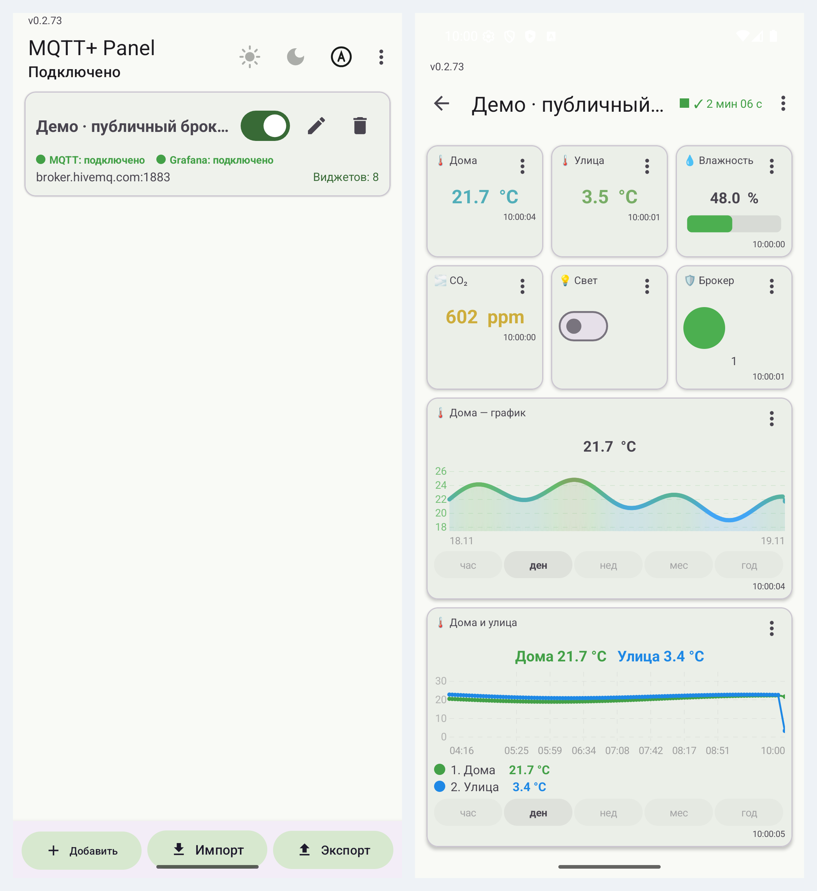
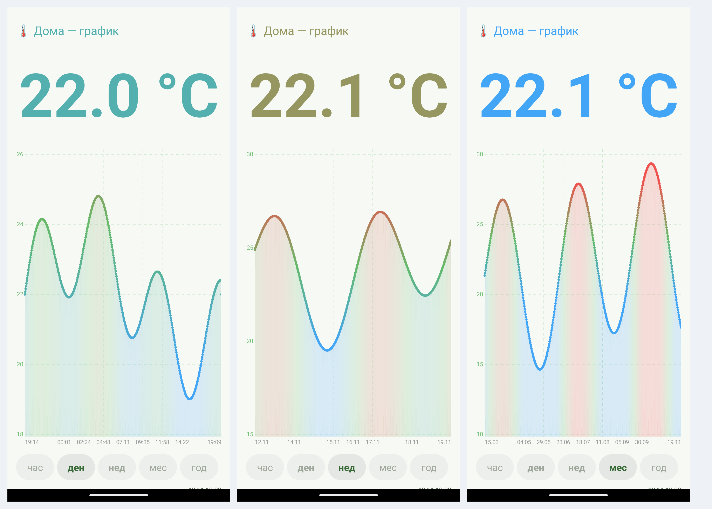
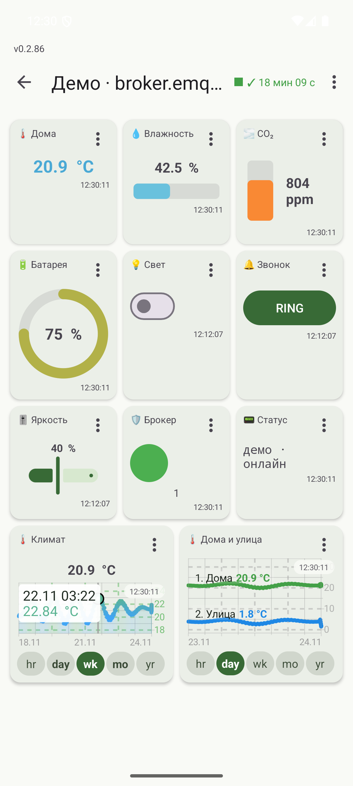

# MQTT+ Panel

**Умный дом и датчики — на одном экране телефона.**

MQTT+ Panel превращает Android-смартфон или планшет в панель наблюдения и управления: показания
всех устройств — температура, влажность, давление, напряжение, заряд батареек — собираются
карточками на одном экране, а кнопки и переключатели управляют ими обратно.

**Текущая версия:** 0.2.85 · Android 7.0+ (minSdk 24) · Kotlin · Eclipse Paho 1.2.5

## Скриншоты

Все скриншоты — демо-дашборд, который приложение создаёт само при первом запуске
(работает без своего брокера и ключей).

<p align="center">
  
  
  
</p>

Главный дашборд · тёмная тема · заблокированная раскладка (плотная сетка, только данные)

<p align="center">
  
</p>

Полноэкранный график: периоды переключаются чипами (сутки → неделя → месяц)

<p align="center">
  
</p>

Крестовина: время и значение под пальцем

## Возможности

### Подключения

- **Несколько брокеров параллельно** — каждое включённое подключение живёт своим клиентом
  со своими подписками и светодиодом статуса.
- **TCP, SSL/TLS, WebSocket** (`ws://`/`wss://`), логин/пароль, Keep Alive, QoS 0–2, Retained.
- **Стабильный Client ID** — два устройства, развёрнутые из одной резервной копии, получают
  разные ID и не выбивают друг друга на брокере.
- **Префикс тем устройства** (например `antonh2o/tuwa3`) — ограничивает сканер топиков этим
  устройством; для конфигов, импортированных из IoT MQTT Panel, определяется автоматически.
- **Сканер топиков** — временная подписка собирает дерево брокера, виджеты создаются пачкой,
  тип подбирается по содержимому; JSON-темы раскрываются в отдельные датчики.

### Виджеты

11 типов: Значение, Переключатель, Кнопка (в т.ч. «payload при отпускании» с автоповтором),
Слайдер (шаг, вертикальный), Светодиод, Текст, График, **Мультиграфик** (несколько топиков
на одном графике, подписи линий с текущими значениями) и Прогресс в трёх вариантах
(вертикальный, горизонтальный, круговой).

- **Динамический цвет** — три опорных цвета по диапазону Мин/Макс: значение, линия графика
  и полоса прогресса красятся цветом своего значения.
- **Время обновления** на каждой карточке (у Народмона — время измерения платформы).
- **Блокировка дашборда** — только данные, без меню и ручек; раскладка переживает перезапуск.

### Графики

- Живые точки из MQTT в реальном времени + история за **сутки / неделю / месяц / год** —
  чипами прямо на карточке и в полноэкранном режиме.
- **Полный экран** по двойному тапу: крупное значение, крестовина (время и значение под
  пальцем), пинч-масштаб по времени, чипы периодов.
- Демо-графики поддерживают те же чипы периодов — история синтезируется приложением.

### История из Grafana

MQTT-подключение связывается с вашим Grafana (InfluxDB через `/api/ds/query`, Grafana 8+):
живые точки остаются из MQTT, история за периоды подтягивается из базы. Настройка — один раз
в редакторе подключения. Пошаговая инструкция — в разделе
[«Настройка Grafana»](#настройка-grafana-история-графиков).

### Народный мониторинг

Датчики [narodmon.ru](https://narodmon.ru) показываются наряду с MQTT: аккаунт подключается
как отдельное «подключение», датчики выбираются из списка своих устройств, тип карточки —
любой (значение, график, прогресс, текст). Нужен свой бесплатный API-ключ narodmon.ru
(в приложении ключа нет; лимит платформы считается на ключ и IP).

### Конфигурация

- **Импорт/экспорт** — файл или Яндекс Диск; импорт конфигураций стороннего дашборда
  (IoT MQTT Panel, старый и новый формат).
- **Резервная копия на Яндекс Диск** — OAuth, автоматический выбор папки, восстановление.
- **Кэш последних данных** — значения и истории показываются мгновенно при открытии.

### Обновление из GitHub

Меню ⋮ → «Проверить обновления», плюс приложение само проверяет новую версию при каждом
запуске и предлагает обновиться: скачивание с индикатором прогресса и кнопкой «Отмена».

### Прочее

Foreground-сервис с автопереподключением (статус и таймер в строке состояния), Material 3,
светлая/тёмная/системная тема, русский и английский интерфейс, журнал диагностики с отправкой
на отладку.

## Первый запуск

Если настроек ещё нет, приложение само создаёт демо-подключение к публичному брокеру
[broker.emqx.io](https://www.emqx.com/ru/mqtt/public-mqtt-broker) и дашборд со всеми 11 типами
виджетов. Показания публикует само приложение на свои топики с уникальным префиксом установки
(`mqttpanel/d…` — установки не мешают друг другу), поэтому дашборд живой сразу. Демо можно
отредактировать или удалить как обычное подключение.

## Обновление из GitHub

Готовый APK лежит в репозитории: [apk/mqtt-panel-0.2.85.apk](apk/mqtt-panel-0.2.85.apk) —
подписан release-ключом разработчика, ставится «установкой из файла». Внутри приложения:
меню ⋮ → «Проверить обновления» скачивает новую версию и сразу открывает установщик.

## Настройка Grafana (история графиков)

Двойной тап по карточке графика открывает его на весь экран (с чипами периодов, если история
загружена). История за 1d/1w/1m/1y подтягивается из InfluxDB вашего Grafana (нужен Grafana 8+).
Настраивается один раз в редакторе подключения (карандаш на карточке подключения → секция
«История из Grafana»):

1. **Адрес Grafana** — как в браузере: `https://grafana.домен` или `http://192.168.1.10:3000`.
2. **Логин / Пароль** — от самого Grafana (basic auth).
3. **Datasource UID** — Connections → Data sources → ваш InfluxDB → UID в адресной строке
   страницы (`/datasources/edit/<UID>`). Можно вписать и **имя** datasource — приложение само
   найдёт UID (нужны права admin).
4. **Measurement / Поле / Тег** — точные имена смотрите в Grafana → Explore: запрос
   `SHOW MEASUREMENTS` покажет измерения. В стандартном стеке MQTT → Telegraf → InfluxDB это
   `mqtt_consumer` / `value` / `topic` (значение тега = полный MQTT-топик карточки; у серий
   мультиграфика — их темы). Если telegraf пишет по именам устройств — measurement будет
   именем устройства (например, `esp32sat`).
5. Сохраните — чипы периодов появятся на всех графиках подключения; живые точки MQTT
   продолжат приходить поверх истории.

Типичные ошибки (все пишутся в журнал — ⋮ → «Отправить журнал»):

- **HTTP 401** — неверный логин/пароль Grafana;
- **HTTP 404 Data source not found** — не тот Datasource UID (если вписано имя — приложение
  само найдёт UID, нужны права admin);
- **«нет данных»** — measurement или поле не те: сверьте с Explore в Grafana, либо точек за
  выбранный период просто нет.

## Установка

1. Скачайте [apk/mqtt-panel-0.2.85.apk](apk/mqtt-panel-0.2.85.apk) или через «Проверить
   обновления» изнутри приложения.
2. Разрешите «Установка приложений» для MQTT Панели (запрос появится при первой установке).
3. Импорт конфигурации: «Импорт» внизу списка подключений → выберите формат:
   - **Другой MQTT-дашборд** — конфигурация стороннего приложения;
   - **MQTT Панель** — экспорт этого приложения (полная замена текущей конфигурации).

## Безопасность и ложные срабатывания антивирусов

**Политика конфиденциальности:** [PRIVACY.md](PRIVACY.md), постоянный адрес для магазинов
приложений — [antonh2o.github.io/mqtt-panel](https://antonh2o.github.io/mqtt-panel/).
Приложение не собирает аналитику и телеметрию; все настройки и пароли хранятся только
на устройстве.

Приложение распространяется как APK вне магазинов приложений, поэтому антивирусы некоторых
оболочек (Vivo, иногда MIUI/HyperOS) могут помечать его как «опасное». Это **ложное
срабатывание**: типичные причины — файл не из магазина, разрешение «Установка приложений»
(нужно для авто-обновления) и самоподписанный разработчик вместо магазинной подписи.

**Google Play Защита при сканировании этого APK отвечает: «Судя по всему, приложение
безопасное»**:


Сборки проверены антивирусной платформой VirusTotal — **вирусов нет**: [отчёт для сборки
0.2.65](https://www.virustotal.com/gui/file/862f162c6e95e194f6649fbbc04faa78ca69ce4e4b045772d078ac66511b2e28).
Любой релизный APK можно проверить самостоятельно на [virustotal.com](https://www.virustotal.com).

Контрольная сумма SHA-256 текущего APK:

```
85ce7a2332e3b1b6e3e42093748e99646bfe1e9c639d23f309403653cb5354da  mqtt-panel-0.2.85.apk
```

Сравните с выводом `sha256sum mqtt-panel-0.2.85.apk` после скачивания. Сумма каждой новой
версии публикуется здесь. Все версии подписаны одним ключом разработчика (RSA/SHA-256,
сертификат до 2054 года) — версии обновляются поверх друг друга.

**Если антивирус оболочки (Vivo/MIUI) блокирует установку** — «Установить всё равно» /
«Игнорировать риск» (пункт может прятаться за «Подробнее»), либо временно отключите сканер.
**Ошибка «конфликтует с другим пакетом»** — на телефоне осталась версия с другой подписью:
сделайте резервную копию в Яндекс Диск → удалите приложение → установите новый APK →
«Восстановить из Яндекс Диска».

## Сборка

Gradle 8.11.1, AGP 8.10.1, Kotlin 2.1.0, JDK 17. Gradle wrapper в репозиторий не входит —
используйте локальный Gradle или Android Studio:

```bash
gradle assembleStandardRelease  # обычная release-сборка (с самообновлением)
gradle assembleStoreRelease     # store-сборка для магазинов (без самообновления)
gradle :app:testDebugUnitTest   # юнит-тесты
```

Release подписывается собственным ключом — положите рядом с проектом `keystore/mqtt-panel.jks`
и `keystore.properties` (`storeFile`, `storePassword`, `keyAlias`, `keyPassword`). Оба пути
в `.gitignore`; без них release не соберётся — используйте `assembleDebug`.

## Архитектура

```
app/src/main/java/ru/mqtt/panel/
├── mqtt/
│   ├── MqttService.kt      # foreground-сервис: несколько брокеров параллельно,
│   │                       # автопереподключение, сканер топиков, publish
│   └── NarodmonService.kt  # foreground-сервис Народного Мониторинга: минутный
│                           # поллинг значений, бэкофф при лимите, userLogon
├── data/
│   ├── AppRepository.kt    # конфиг в JSON (config.json + backup, атомарная запись)
│   ├── Panel.kt            # модель виджета; source: mqtt|narodmon; серии мультиграфика
│   ├── DemoConfig.kt       # демо-дашборд первого запуска + синтетическая история
│   ├── NarodmonApi.kt      # REST-клиент narodmon.ru
│   ├── GrafanaApi.kt       # история из InfluxDB через /api/ds/query
│   └── IotMqttPanelImporter.kt
└── ui/
    ├── MainActivity.kt / ConnectionListFragment.kt   # подключения, импорт/экспорт
    ├── DashboardActivity.kt                          # сетка виджетов, сканер, редактор
    ├── WidgetAdapter.kt                              # рендер 11 типов карточек
    └── ChartView.kt                                  # график: серии, перекрестие,
                                                       # подписи линий, пинч-масштаб
```

Сообщения рассылаются на UI через `LocalBroadcast`; narodmon-сервис использует тот же
broadcast (в «теме» — ID датчика), поэтому маршрутизация значений, графики и статусы общие
для обоих источников.

## Лицензия

См. [LICENSE](LICENSE).
