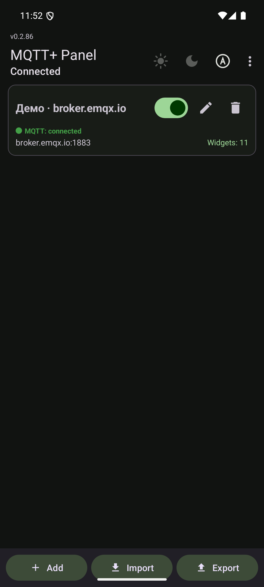
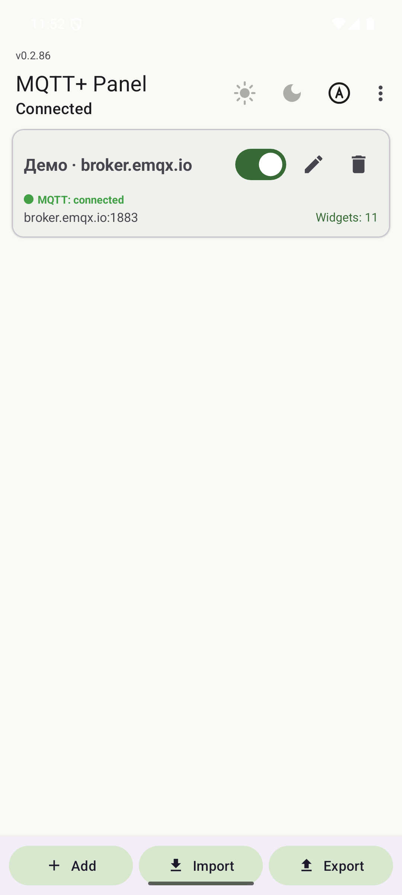
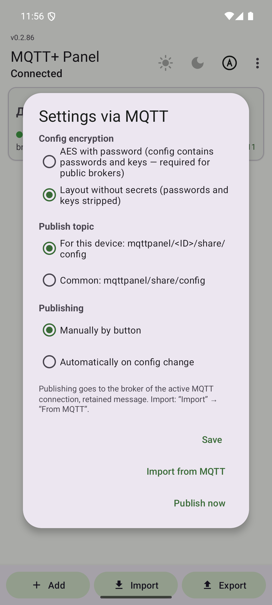
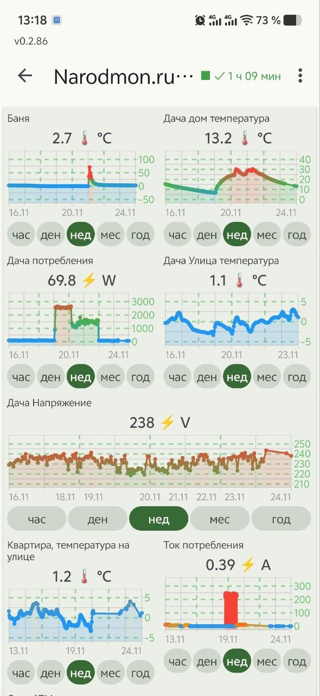
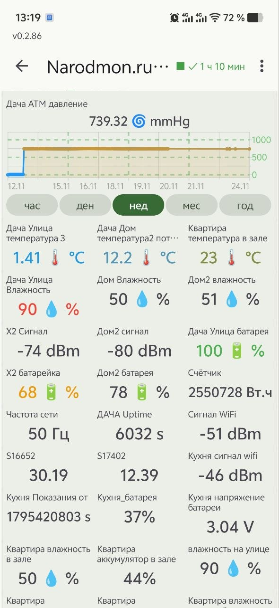
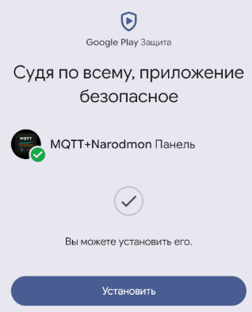

# MQTT+ Panel

**Умный дом и датчики — на одном экране телефона.**

MQTT+ Panel превращает Android-смартфон или планшет в панель наблюдения и управления: показания
всех устройств — температура, влажность, давление, напряжение, заряд батареек — собираются
карточками на одном экране, а кнопки и переключатели управляют ими обратно. Данные приходят
из любого MQTT-брокера и с платформы Народного Мониторинга (narodmon.ru); историю графиков за
час…год карточки подтягивают из InfluxDB вашего Grafana.

**Текущая версия:** 0.2.86 · Android 7.0+ (minSdk 24) · Kotlin · Eclipse Paho 1.2.5

## Скриншоты

Скриншоты, кроме Народного Мониторинга, — демо-дашборд, который приложение создаёт само
при первом запуске (работает без своего брокера и ключей). Кадры Народного Мониторинга —
реальный аккаунт владельца.

|  |  |
|:---:|:---:|
| **Демо-дашборд при первом запуске: 11 типов виджетов с живыми данными** | **Тёмная тема** |
|  |  |
| **Заблокированная раскладка: плотная сетка, только данные** | **Настройки обмена конфигом через MQTT** |
|  |  |
| **Народный Мониторинг: графики датчиков (история за неделю)** | **Народный Мониторинг: значения всех датчиков аккаунта** |

<p align="center">
  <br>
  <b>Крестовина: время и значение под пальцем</b>
</p>

<p align="center">
  <br>
  <b>Полноэкранный график: периоды переключаются чипами 1d → 1w → 1m</b>
</p>

## Первый запуск

Если настроек ещё нет, приложение само создаёт демо-подключение к публичному брокеру
[broker.emqx.io](https://www.emqx.com/ru/mqtt/public-mqtt-broker) и дашборд со всеми 11 типами
виджетов. Показания публикует само приложение на свои топики с уникальным префиксом установки
(`mqttpanel/d…` — установки не мешают друг другу), поэтому дашборд живой сразу. Демо можно
отредактировать или удалить как обычное подключение.

## Обновление из GitHub

Готовый APK лежит в репозитории: [apk/mqtt-panel-0.2.86.apk](apk/mqtt-panel-0.2.86.apk) —
подписан release-ключом разработчика, ставится «установкой из файла». Внутри приложения:
меню ⋮ → «Проверить обновления» скачивает новую версию и сразу открывает установщик.

## Народный Мониторинг (narodmon.ru)

Второй источник данных наряду с MQTT: карточки и графики ваших датчиков с платформы
Народного Мониторинга — значения, история за час/день/неделю/месяц/год, время последней
передачи. Значения, графики и статусы маршрутизируются так же, как у MQTT-карточек.

Подключение настраивается один раз: «Добавить» на главном экране → включите «Народмон»:

1. **API-ключ** — личный, у каждого пользователя свой: narodmon.ru → «Мои приложения» →
   создайте приложение и включите галочку «Активно». Ключ нигде не публикуйте — лимит
   платформы считается на пару «ключ + IP».
2. **Логин / Пароль** — от самого аккаунта narodmon.ru (приложение раз в сутки выполняет
   вход; API-ключ в поле пароля не работает).
3. Датчики добавляются карточками из списка ваших датчиков; кнопка **«Добавить все
   датчики разом»** создаёт карточки для всех сразу — имена и единицы измерения
   подставляются с платформы.

Платформа ограничивает 3 запроса в минуту на ключ+IP: приложение опрашивает значения
раз в минуту (с бэкоффом при лимите), историю графиков подгружает не чаще раза в
полчаса. При превышении лимита платформа перестаёт отвечать — подождите 5–10 минут.

## Настройка Grafana (история графиков)

Двойной тап по карточке графика открывает его на весь экран (с чипами периодов, если история
загружена). История за 1d/1w/1m/1y подтягивается из InfluxDB вашего Grafana (нужен Grafana 8+).
Настраивается один раз в редакторе подключения (карандаш на карточке подключения → секция
«История из Grafana»):

1. **Адрес Grafana** — как в браузере: `https://grafana.домен` или `http://192.168.1.10:3000`.
2. **Логин / Пароль** — от самого Grafana (basic auth).
3. **Datasource UID** — Connections → Data sources → ваш InfluxDB → UID в адресной строке
   страницы (`/datasources/edit/<UID>`). Можно вписать и **имя** datasource — приложение само
   найдёт UID (нужны права admin).
4. **Measurement / Поле / Тег** — точные имена смотрите в Grafana → Explore: запрос
   `SHOW MEASUREMENTS` покажет измерения. В стандартном стеке MQTT → Telegraf → InfluxDB это
   `mqtt_consumer` / `value` / `topic` (значение тега = полный MQTT-топик карточки; у серий
   мультиграфика — их темы). Если telegraf пишет по именам устройств — measurement будет
   именем устройства (например, `esp32sat`).
5. Сохраните — чипы периодов появятся на всех графиках подключения; живые точки MQTT
   продолжат приходить поверх истории.

Типичные ошибки (все пишутся в журнал — ⋮ → «Отправить журнал»):

- **HTTP 401** — неверный логин/пароль Grafana;
- **HTTP 404 Data source not found** — не тот Datasource UID (если вписано имя — приложение
  само найдёт UID, нужны права admin);
- **«нет данных»** — measurement или поле не те: сверьте с Explore в Grafana, либо точек за
  выбранный период просто нет.

## Установка

1. Скачайте [apk/mqtt-panel-0.2.86.apk](apk/mqtt-panel-0.2.86.apk) или через «Проверить
   обновления» изнутри приложения.
2. Разрешите «Установка приложений» для MQTT Панели (запрос появится при первой установке).
3. Импорт конфигурации: «Импорт» внизу списка подключений → выберите формат:
   - **Другой MQTT-дашборд** — конфигурация стороннего приложения;
   - **MQTT Панель** — экспорт этого приложения (полная замена текущей конфигурации).

## Безопасность и ложные срабатывания антивирусов

**Политика конфиденциальности:** [PRIVACY.md](PRIVACY.md), постоянный адрес для магазинов
приложений — [antonh2o.github.io/mqtt-panel](https://antonh2o.github.io/mqtt-panel/).
Приложение не собирает аналитику и телеметрию; все настройки и пароли хранятся только
на устройстве.

Приложение распространяется как APK вне магазинов приложений, поэтому антивирусы некоторых
оболочек (Vivo, иногда MIUI/HyperOS) могут помечать его как «опасное». Это **ложное
срабатывание**: типичные причины — файл не из магазина, разрешение «Установка приложений»
(нужно для авто-обновления) и самоподписанный разработчик вместо магазинной подписи.

**Google Play Защита при сканировании этого APK отвечает: «Судя по всему, приложение
безопасное»**:



Сборки проверены антивирусной платформой VirusTotal — **вирусов нет**: [отчёт для сборки
0.2.65](https://www.virustotal.com/gui/file/862f162c6e95e194f6649fbbc04faa78ca69ce4e4b045772d078ac66511b2e28).
Любой релизный APK можно проверить самостоятельно на [virustotal.com](https://www.virustotal.com).

Контрольная сумма SHA-256 текущего APK:

```
90fd97f443a1787fa1c374187f9cac55b0f3c8cae1e4390a741c1c886be3bec4  mqtt-panel-0.2.86.apk
```

Сравните с выводом `sha256sum mqtt-panel-0.2.86.apk` после скачивания. Сумма каждой новой
версии публикуется здесь. Все версии подписаны одним ключом разработчика (RSA/SHA-256,
сертификат до 2054 года) — версии обновляются поверх друг друга.

**Если антивирус оболочки (Vivo/MIUI) блокирует установку** — «Установить всё равно» /
«Игнорировать риск» (пункт может прятаться за «Подробнее»), либо временно отключите сканер.
**Ошибка «конфликтует с другим пакетом»** — на телефоне осталась версия с другой подписью:
сделайте резервную копию в Яндекс Диск → удалите приложение → установите новый APK →
«Восстановить из Яндекс Диска».

## Сборка

Gradle 8.11.1, AGP 8.10.1, Kotlin 2.1.0, JDK 17. Gradle wrapper в репозиторий не входит —
используйте локальный Gradle или Android Studio:

```bash
gradle assembleStandardRelease  # обычная release-сборка (с самообновлением)
gradle assembleStoreRelease     # store-сборка для магазинов (без самообновления)
gradle :app:testDebugUnitTest   # юнит-тесты
```

Release подписывается собственным ключом — положите рядом с проектом `keystore/mqtt-panel.jks`
и `keystore.properties` (`storeFile`, `storePassword`, `keyAlias`, `keyPassword`). Оба пути
в `.gitignore`; без них release не соберётся — используйте `assembleDebug`.

## Архитектура

```
app/src/main/java/ru/mqtt/panel/
├── mqtt/
│   ├── MqttService.kt      # foreground-сервис: несколько брокеров параллельно,
│   │                       # автопереподключение, сканер топиков, publish
│   └── NarodmonService.kt  # foreground-сервис Народного Мониторинга: минутный
│                           # поллинг значений, бэкофф при лимите, userLogon
├── data/
│   ├── AppRepository.kt    # конфиг в JSON (config.json + backup, атомарная запись)
│   ├── Panel.kt            # модель виджета; source: mqtt|narodmon; серии мультиграфика
│   ├── DemoConfig.kt       # демо-дашборд первого запуска + синтетическая история
│   ├── NarodmonApi.kt      # REST-клиент narodmon.ru
│   ├── GrafanaApi.kt       # история из InfluxDB через /api/ds/query
│   └── IotMqttPanelImporter.kt
└── ui/
    ├── MainActivity.kt / ConnectionListFragment.kt   # подключения, импорт/экспорт
    ├── DashboardActivity.kt                          # сетка виджетов, сканер, редактор
    ├── WidgetAdapter.kt                              # рендер 11 типов карточек
    └── ChartView.kt                                  # график: серии, перекрестие,
                                                       # подписи линий, пинч-масштаб
```

Сообщения рассылаются на UI через `LocalBroadcast`; narodmon-сервис использует тот же
broadcast (в «теме» — ID датчика), поэтому маршрутизация значений, графики и статусы общие
для обоих источников.

## Лицензия

См. [LICENSE](LICENSE).
